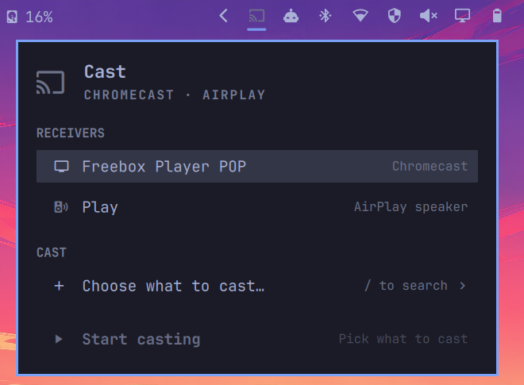
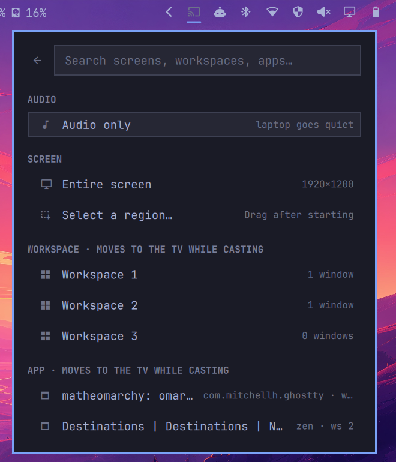

# Aircast for Omarchy

An Omarchy bar widget that casts to a Chromecast or AirPlay TV. You can cast:

- **the entire screen** (any monitor)
- **a region** you drag out with the mouse
- **a workspace**
- **a single app**, shown full screen on the TV
- **audio only**, to a TV or to a speaker (Google Home/Nest, Sonos, HomePod and
  other AirPlay speakers)

<p>
  
  
</p>

### What "moves to the TV while casting" means

Hyprland can't render a workspace that isn't on a monitor. So for a workspace
or an app, Aircast creates an invisible extra monitor (`AIRCAST-1`) the size of
the TV and moves the workspace or window onto it. Only the TV shows that
monitor. While you cast, the workspace or app is **gone from your laptop
screen** and the rest of your desktop stays private. The virtual monitor sits
to the right of your real one, so you can still reach it with the mouse or with
`SUPER + <workspace>`. When you stop, everything moves back where it was,
including the window's floating and fullscreen state.

Casting the entire screen or a region mirrors what you see and moves nothing.

### Audio only

While audio is cast, your laptop's speakers go quiet and every app plays to
the receiver. When you stop, the previous output comes back.

- **Chromecast and Google speakers:** apps play into a silent PipeWire output
  called *Aircast*. Its sound is encoded to AAC and streamed live, like the
  video path.
- **AirPlay speakers:** PipeWire's own AirPlay output (from
  `pipewire-zeroconf`) becomes the default output while casting. Volume keys
  then control the speaker. AirPlay audio has about 2 s of built-in delay.

## How it works

```
gpu-screen-recorder ─┐                 ┌─ live fragmented MP4 ─► Chromecast   (~1 s)
   (screen, region)  ├─► H.264 + AAC ──┤
wf-recorder + ffmpeg ┘                 └─ HLS, 0.5 s segments ─► AirPlay     (~2–3 s)
   (virtual display)
```

The desktop is encoded to H.264/AAC with a keyframe every 0.5 s, and a small
HTTP server on this computer serves it to the receiver:

- **Chromecast, low latency (default):** one endless fragmented MP4 stream,
  cut into ~0.1 s fragments that the TV plays as they arrive. A TV that
  connects joins at the next keyframe instead of replaying older video. The
  delay is well under a second with hardware encoding.
- **AirPlay, or Chromecast with `lowLatency` off:** live HLS. The receiver
  waits for a few finished segments before playing, so the delay is about
  2–3 s. Apple TVs can't play an endless MP4, so AirPlay always uses HLS.

What still adds delay, from biggest to smallest:

1. **CPU encoding.** Without a VA-API driver, gpu-screen-recorder falls back
   to x264. Aircast tunes it for zero latency (slice threads instead of frame
   threads, which would otherwise hold back ~1 frame per CPU thread), but a
   hardware encoder is faster still. On Intel GPUs the widget offers
   **Install Intel video driver** (`intel-media-driver`).
2. **The TV's own buffer.** The default Cast receiver buffers a little before
   it starts and doesn't speed up to catch up after a stall. Getting below
   that would need a custom receiver app, which has to be registered with
   Google and hosted on the web.
3. **Wi-Fi.** A wired TV or 5 GHz Wi-Fi helps; lower `resolution`/`fps` help
   on a busy network. If playback stutters in low-latency mode, turn `lowLatency` off;
   HLS buffers more and copes better with weak Wi-Fi.

Workspaces and apps use a headless Hyprland output (`AIRCAST-1`).
gpu-screen-recorder captures through KMS and can't see headless outputs, so
those two modes record with `wf-recorder`.

## Requirements

| Need | For | Install |
|------|-----|---------|
| `gpu-screen-recorder`, `slurp`, `jq`, `python3`, `avahi` | everything (all ship with Omarchy) | — |
| `wf-recorder`, `ffmpeg` | casting a workspace or an app | **Install wf-recorder** row in the widget |
| `intel-media-driver` | hardware H.264 encoding on Intel GPUs (lower delay) | **Install Intel video driver** row (shown when it's missing) |
| `pipewire-zeroconf` | audio to AirPlay speakers | **Install AirPlay audio** row (shown when an AirPlay speaker is found) |
| `pyatv` (`atvremote`) | AirPlay to modern Apple TVs | **Install pyatv** row (shown when an AirPlay TV is found) |

`omarchy plugin add` never runs install scripts, so the widget's **Setup**
section offers the missing pieces instead. Each row opens a terminal for sudo
and runs `aircast install`, which calls `omarchy pkg add` (or `omarchy pkg aur
add` for pyatv). Clicking a workspace or app before wf-recorder is installed
does the same.

The Chromecast sender, legacy AirPlay sender, stream servers and device
discovery are bundled, stdlib-only Python scripts in `lib/`.

### Firewall (one time)

Omarchy's firewall (ufw) blocks incoming connections, but the TV has to fetch
the stream from this computer, and AirPlay speakers send timing packets back to
it (UDP 6001–6002). Allow these ports from your local network only:

```bash
~/.config/omarchy/plugins/matheoatche.aircast/bin/aircast firewall
```

The widget shows an **Open firewall** row until this is done.

The stream is plain HTTP with no authentication. While you cast, anyone on
your local network who knows the port can watch it too. Nothing is served when
you aren't casting. The rules only allow private address ranges and the IPv6
prefixes of the networks you're on when you run the command.

### AirPlay pairing

Modern Apple TVs only accept streams from paired devices. Pair once:

```bash
atvremote scan
atvremote -s <apple-tv-ip> --protocol airplay pair
```

Without pyatv, Aircast falls back to the original unauthenticated AirPlay
`/play` request. That works with older Apple TVs, Kodi and many third-party
receivers.

## Install

```bash
omarchy plugin add https://github.com/MatheoAtche/omarchy-aircast.git --enable
```

Or, from a local checkout:

```bash
ln -s "$PWD" ~/.config/omarchy/plugins/matheoatche.aircast
omarchy-shell shell rescanPlugins
omarchy plugin enable matheoatche.aircast
```

## Uninstall

Stop any cast, close the firewall ports Aircast opened, then remove the plugin:

```bash
~/.config/omarchy/plugins/matheoatche.aircast/bin/aircast stop
~/.config/omarchy/plugins/matheoatche.aircast/bin/aircast firewall --remove
omarchy plugin remove matheoatche.aircast
```

Then delete any Aircast keybindings you added and, if you like, the last-used
receiver in `~/.local/state/omarchy-aircast/`. Packages installed from the
**Setup** section (`wf-recorder`, `pyatv`, `pipewire-zeroconf`,
`intel-media-driver`) stay installed; remove them with `omarchy pkg remove` if
nothing else needs them.

## Use

Click the cast icon in the bar, pick a receiver, pick what to cast, then
**Start casting**. While casting, the icon is lit. Right-click it to stop.

What to cast is picked in its own view: type to fuzzy-search screens,
workspaces and apps by title, app class or workspace.

Popup keys: `j`/`k` or arrows move, `enter`/`space` select, `/` opens the
source search, `s` starts or stops, `r` rescans receivers and windows, `esc`
closes. In the search, arrows or `ctrl+n`/`ctrl+p` move, `enter` picks, and
`esc` clears the query, then goes back.

### Settings

Edit them in Omarchy's widget settings, or inline on the `matheoatche.aircast`
entry in `~/.config/omarchy/shell.json`:

| Key | Default | |
|-----|---------|-|
| `resolution` | `1920x1080` | Stream size limit, and the size of the virtual display |
| `fps` | `30` | Frame rate |
| `audio` | `true` | Send desktop audio |
| `lowLatency` | `true` | Chromecast: live MP4 (~1 s) instead of HLS (~2–3 s) |
| `port` | `8765` | Port the receiver pulls from (re-run `aircast firewall` after changing it) |

### Command line

`bin/aircast` does all the work. The widget is a front end for it.

```bash
aircast devices                                   # receivers on the LAN (JSON)
aircast sources                                   # monitors, workspaces, windows (JSON)
aircast start chromecast:ea83… screen             # focused monitor
aircast start chromecast:ea83… screen:DP-2
aircast start chromecast:ea83… region             # drag a rectangle
aircast start chromecast:ea83… workspace:3
aircast start airplay:a1b2c3… window:0x55a8d41108f0
aircast start airplay:804af2b0b1b8 audio          # system sound to a speaker
aircast stop
aircast status
aircast start chromecast:ea83… screen --no-low-latency
aircast doctor                                    # missing tools, firewall
aircast firewall --remove                         # close the ports again
aircast install                                   # install missing optional tools
```

### Keybindings

The popup opens from the keyboard too, so the whole flow works without the
mouse. Example Hyprland bindings (`~/.config/hypr/bindings.lua`):

```lua
o.bind("SUPER + ALT + C", "Cast",
  hl.dsp.exec_cmd("omarchy-shell matheoatche.aircast toggle"))
o.bind("SUPER + SHIFT + ALT + C", "Stop casting",
  hl.dsp.exec_cmd("~/.config/omarchy/plugins/matheoatche.aircast/bin/aircast stop"))
```

### Why not WebRTC?

WebRTC could get Chromecast down to roughly 0.2–0.4 s, but the standard Cast
player can't receive it. It would need a custom receiver: a web page hosted
on HTTPS and registered in Google's Cast Developer Console ($5, one time).
Unpublished receivers only run on devices registered there by serial number.
The WebRTC handshake would go over the Cast connection, so the stream itself
could stay on the LAN. AirPlay has no WebRTC option at all.

## Development

Quickshell caches QML that lives outside its config folder. If the plugin is
symlinked into `~/.config/omarchy/plugins/`, run `omarchy restart shell` after
editing `Panel.qml`. Changes to `bin/` and `lib/` take effect immediately.

## Troubleshooting

- **Playback stutters or keeps catching up.** Turn off `lowLatency`. The
  session log shows `receiver: buffering` each time the TV stalls.
- **The receiver shows a spinner, then stops.** It can't reach the stream. Run
  `aircast firewall`. Check that the TV and this computer are on the same
  network (guest Wi-Fi often isolates clients).
- **An AirPlay speaker is selected but stays silent.** The speaker's timing
  packets are being blocked. Run `aircast firewall` again; older versions only
  opened the stream port.
- **The image is choppy, or there's a `vaInitialize failed` line in the log.**
  There's no working VA-API driver, so gpu-screen-recorder is encoding on the
  CPU. Install your GPU's VA-API driver (for example `intel-media-driver`), or
  lower `resolution`/`fps`.
- Session log: `$XDG_RUNTIME_DIR/omarchy-aircast/session.log`.
- If something kills the session hard, `aircast stop` still moves windows back
  and removes the virtual display.
